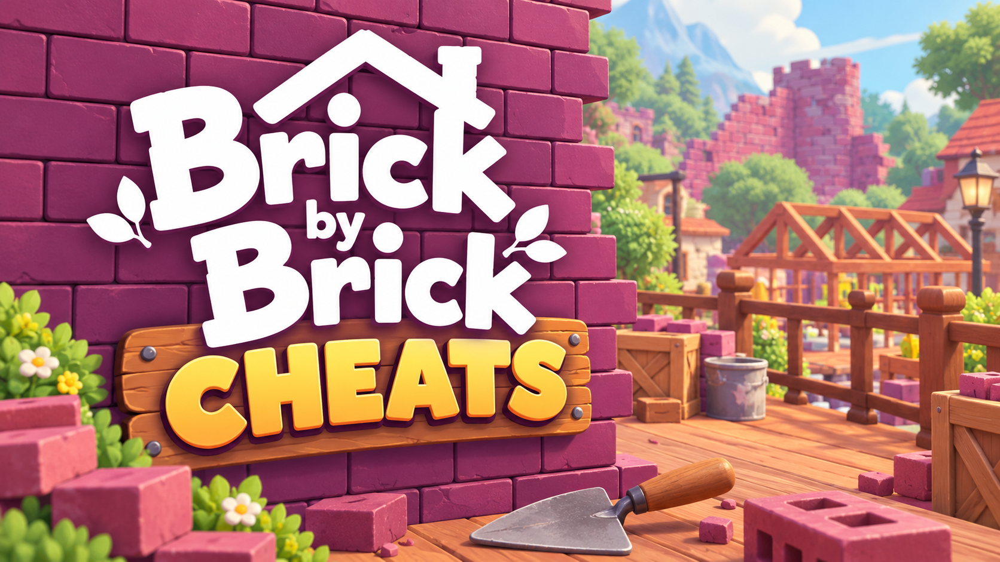

# Brick by Brick: Tidy Up the Small Town! — Cheats

**Colour-blind brick markers, magnet range, infinite carry, auto-sort, instant placement, every ability and building unlocked.**

    

> **[⬇️ Download the latest Brick by Brick cheats](../../releases/latest)**

    

[18,490](#eighteen-thousand-four-hundred-and-ninety) · [Colour sorting](#the-colour-problem) · [Settings](#settings) · [Questions](#questions)

---

## Eighteen thousand four hundred and ninety

That is how many bricks PaperPixel say it takes to rebuild the town. They put the number on the store page, which is a confident thing to do, and they were right to — watching the piles shrink and the finished buildings light up is the whole reward structure.

It is also, unavoidably, eighteen thousand four hundred and ninety bricks. Every cheat question in this game reduces to one thing: **how many of them do you want to skip, and at what point have you stopped playing?**

So instead of a feature dump, here is a ladder. Pick a rung.

| Rung | What you turn on | What you are still doing |
|---|---|---|
| **0 — nothing** | — | All of it, as designed. The correct starting point. |
| **1 — comfort** | Colour-blind markers, field of view, interface scale | All of it, with the colour barrier removed |
| **2 — less walking** | Infinite carry, magnet range 3x, movement speed 2x | Finding, sorting and placing every brick |
| **3 — less hunting** | Add: highlight matching bricks, reveal brick locations | Sorting and placing every brick |
| **4 — less sorting** | Add: auto-sort by shape and colour | Placing every brick |
| **5 — tourism** | Add: instant placement, auto-build | Looking at a town somebody else tidied |

Rung 2 is where most people will be happy. Rung 5 is a screenshot tool.

## The colour problem

The core loop asks you to sort bricks **by shape and by colour**. Shape is fine for everyone. Colour is not.

Roughly one in twelve men and one in two hundred women has some degree of colour vision deficiency, and a sorting game built on red-green-brown brick tones is close to a worst case. There is no built-in option for it at launch.

**Colour-blind brick markers** overlays a distinct symbol and pattern on each brick colour — not a filter over the whole screen, which does not help, but a per-brick tag you can read at a glance. It changes nothing about where bricks go, how many there are, or how long it takes. It makes the colour channel legible.

If that is the only thing you take from this page, it is the one worth taking.

| Setting | Scope |
|---|---|
| Colour-blind brick markers | Client |
| Marker style — symbol, pattern, numeral | Client |
| High-contrast brick outlines | Client |
| Blueprint slot labelling | Client |
| Field of view `60`–`120 deg` | Client |
| Interface scale `75%`–`200%` | Client |
| Reduce head bob | Client |

## Settings

### Builder

| Setting | Key | Scope |
|---|---|---|
| Infinite stamina | <kbd>F1</kbd> | Client |
| Carry capacity `1`–`200` bricks | slider | Client |
| Wheelbarrow capacity `1x`–`20x` | slider | Client |
| Movement speed `1x`–`6x` | slider | Client |
| Reach distance `1`–`15 m` | slider | Client |
| No fall damage from scaffolding | <kbd>F2</kbd> | Client |
| Instant scaffolding | — | **`crew`** |
| Unlock all abilities | — | `save` |

### Bricks

| Setting | Key | Scope |
|---|---|---|
| Magnet range `2`–`50 m` | slider | Client |
| Magnet strength `1x`–`10x` | slider | Client |
| Highlight bricks matching the current slot | <kbd>F3</kbd> | Client |
| Reveal all brick locations | <kbd>F4</kbd> | Client, radius `20`–`400 m` |
| Auto-sort by shape and colour | <kbd>F5</kbd> | Client |
| Teleport carried bricks to the build site | <kbd>F6</kbd> | Client |
| Infinite bricks | — | **`crew`** — ignores the 18,490 entirely |
| Bricks never scatter on drop | — | Client |

### Building

| Setting | Key | Scope |
|---|---|---|
| Blueprint snap assist | — | Client, `comfort` |
| No misplacement penalty | — | Client |
| Instant placement | <kbd>F7</kbd> | **`crew`** |
| Auto-build a structure | <kbd>F8</kbd> | **`crew`**, `bypass` — off by default |
| Complete the current building | — | **`crew`**, `save` |
| Unlock all buildings | — | `save` |
| Unlock all decorations | — | `save` |
| Town completion `0%`–`100%` | slider | **`crew`**, `save` |

**Auto-build** is the only thing here tagged `bypass`, and the town completion slider is the only one that can end the game in a single drag. Both are in the menu because somebody will want them. Neither should be your first toggle.

### Co-op

Up to five of you share one town, so most build settings are shared by definition.

| Setting | Key | Scope |
|---|---|---|
| Teleport to a teammate | <kbd>F9</kbd> | Client |
| See teammates through buildings | — | Client |
| Hand bricks across any distance | — | **`crew`** |
| Sync unlocked abilities to the party | — | **`crew`** |
| Task highlight — who is on what | — | Client |

Host-only mode ships enabled and blocks `crew` settings for guests. Five people splitting collecting, sorting, hauling and building is the intended experience; one person auto-building the structure the other four are working on is not.

### Display and menu

Free camera <kbd>F11</kbd>, hide interface <kbd>F12</kbd>, time of day, disable depth of field, screenshot mode. Plus host-only mode, rolling save backup, read-only mode, achievement blocking, rebindable menu key and overlay opacity.

## Keys

<kbd>Insert</kbd> menu · <kbd>End</kbd> reset all · <kbd>F1</kbd> stamina · <kbd>F2</kbd> no fall damage · <kbd>F3</kbd> highlight matches · <kbd>F4</kbd> reveal bricks · <kbd>F5</kbd> auto-sort · <kbd>F6</kbd> teleport bricks · <kbd>F7</kbd> instant placement · <kbd>F8</kbd> auto-build · <kbd>F9</kbd> teleport to teammate · <kbd>F11</kbd> free camera · <kbd>F12</kbd> hide HUD

All rebindable, arrows and <kbd>Enter</kbd> for mouse-free navigation.

## Questions

Is there any way this causes trouble?

No. It is a cooperative tidying game with no competitive mode, no leaderboard and no anti-cheat. Only the people sharing your town are affected, and only by settings marked <code>crew</code>.

Can it help if I am colour-blind?

That is what the brick markers are for. Each colour gets a distinct symbol, pattern or numeral drawn on the brick itself, so you sort by something other than hue. It does not reduce the brick count or change where anything goes.

What should I turn on if I just find the hauling tedious?

Carry capacity around 60, magnet range 3x, movement speed 2x. You still find, sort and place every brick — you simply stop making eleven trips to the same pile.

Will using this in co-op ruin it for the others?

It can. The town is shared, so instant placement and auto-build change what everyone is looking at. Host-only mode blocks those for guests by default, and the honest move is to agree on a rung from the table above before you start.

Does the town completion slider skip the ending?

Yes, completely and permanently. Dragging it to 100% finishes the town, triggers whatever comes with that, and there is no undo short of restoring a backup. It exists for people on a second playthrough.

Settings stopped responding after a patch.

Address shifts from a game update break settings one at a time rather than all together. Compare your build to the release notes, or enable read-only mode to see which values the menu can still read correctly.

My antivirus removed the file.

Inspecting and writing another program's memory is the defining behaviour of this kind of tool, and also of software you would not want on your machine, so scanners flag the category rather than judging the individual case. A checksum accompanies every release and the source is in this repository. Excluding it is a decision you are free to make either way.

## When something misbehaves

Brick settings bind to a loaded town, not the main menu — start or join a game before attaching. Building settings bind per structure, so switching to a different building means re-toggling. Magnet range above about 30 metres will pull in bricks earmarked for a building on the other side of town, which is technically working as configured and still annoying.

If the menu refuses to open, something else holds <kbd>Insert</kbd>; Steam's overlay and Discord are the usual two. If the frame rate drops with reveal-all-bricks on, lower the radius — the game is drawing an outline on every brick within it, and there are a lot of bricks.

[Open an issue](../../issues) with the **game build number** first, then host or guest, which building, and the single setting that failed.

## Version history

**1.0.0** — 18 October 2026 — first build, three days after launch. 35+ settings across Accessibility, Builder, Bricks, Building, Co-op and Display. Host-only mode and rolling backup on by default; auto-build off by default.

---

Unofficial fan tool, no connection to PaperPixel Games or Valve. Brick by Brick: Tidy Up the Small Town! and its assets belong to them. Writing into a live process can crash it or damage a save — keep backups and accept that risk knowingly. MIT licence.

